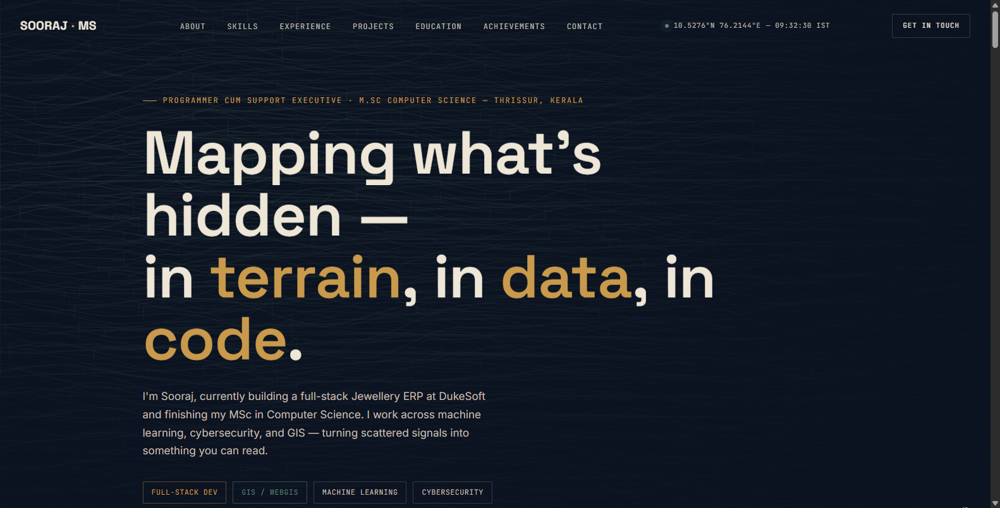
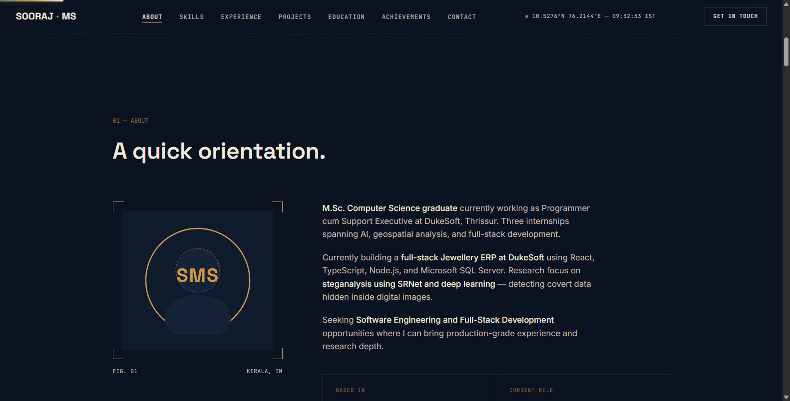

# ✨ Sooraj MS — Developer Portfolio & Profile Editor

<div align="center">

[](https://react.dev/)
[](https://www.typescriptlang.org/)
[](https://vitejs.dev/)
[](https://supabase.com/)
[](LICENSE)

A modern, highly customizable personal developer portfolio and resume website built with React, TypeScript, and Supabase for live content updates.

<br/>



</div>

---

## 📸 Previews

| Interactive Hero Showcase | About & Engineering Bio |
| :---: | :---: |
|  |  |
| **Hero & Engineering Tags** | **Bio, Experience & Research Focus** |

---

## ✨ Features

- 💼 **Full-Stack Profile Hub**: Highlights work experience, research papers, technical skills, and featured software projects.
- ⚡ **Supabase Backend Integration**: Real-time content synchronization allows updating skills, bios, and links without redeploying code.
- 🌐 **Responsive Studio UI**: Tailored typography, GPS coordinate HUD, and dark mode aesthetic.
- 🛡️ **Steganography & AI Showcase**: Dedicated showcase sections for deep learning research (SRNet) and GIS spatial projects.

---

## 🚀 How to Run

1. **Install Dependencies**:
   ```bash
   npm install
   ```
2. **Start Dev Server**:
   ```bash
   npm run dev
   ```
   Then open [`http://localhost:5173`](http://localhost:5173).
3. **Build for Production**:
   ```bash
   npm run build
   ```

---

## 📄 License

MIT License © 2026 [Sooraj Studio](https://github.com/soorajstudio)
